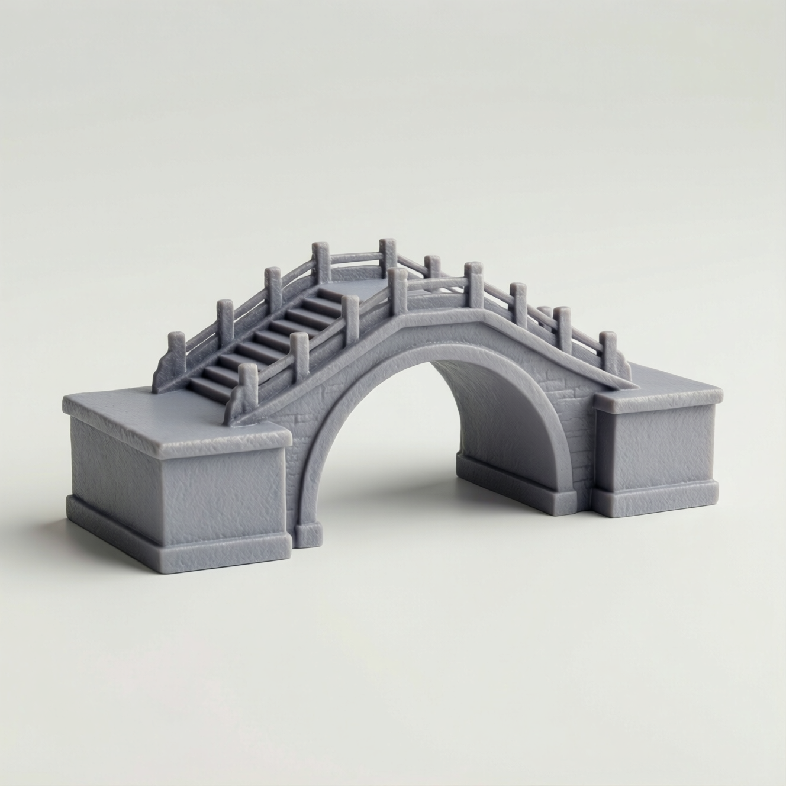
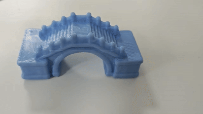

# Text-to-3D Pipeline

一个从文本描述生成可渲染、可打印 GLB 模型的离线流水线。


## 流程

1. 文本语义分析与几何规划
2. 生成多张候选参考图
3. 视觉语言模型筛选参考图
4. Pixal3D 单图生成三维模型
5. 网格清理、定向、缩放和打印约束处理
6. Blender 渲染和结果打包

## 仓库范围

本仓库只包含通用流程源码、环境版本清单和复现说明，不包含：

- 输入提示词集合或数据集
- 生成结果、评测结果或运行日志
- 模型权重及 Hugging Face 缓存
- Conda 环境和 Blender 二进制文件
- 演示文稿、报告或其他材料
- 第三方项目源码

输入 JSONL 的每一行至少包含以下字段：

```json
{"prompt_id":"example_001","prompt":"待生成三维物体的文本描述"}
```

完整环境准备和执行方法见 [docs/REPRODUCTION.md](docs/REPRODUCTION.md)。
